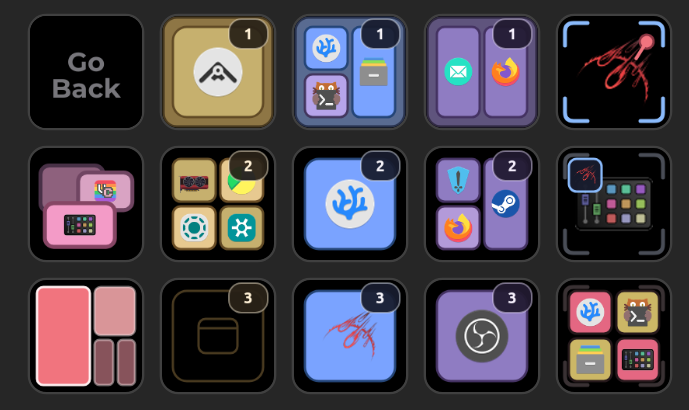
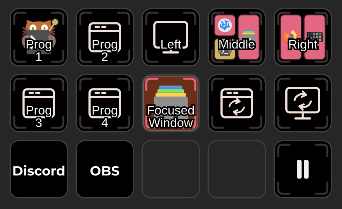

<p align="center">
  
</p>

<h1 align="center">Umbriel Controls for OpenDeck</h1>

<p align="center">
  Control the Umbriel compositor from your Stream Deck.
</p>

This is an OpenAction plugin for interacting with the
[Umbriel compositor](https://github.com/noctalia-dev/umbriel). You need
[OpenDeck](https://github.com/nekename/OpenDeck) to use it.

It has actions for:

- Switching **workspaces**, and moving windows or columns between them.
- Cycling through **workspace layouts**.
- Toggling **scratchpads** (and moving windows in and out of them).
- Setting PipeWire **screencast** targets (and pausing sharing).
- Sending your own **IPC requests via JSON** for anything else.

It also looks pretty :) yay




(The general idea is to pick functionality where visual feedback or the specificity of
control is useful compared to just a keyboard shortcut.)

> [!WARNING]
> Umbriel is still under active development, so changes to its IPC may break this
> plugin. I've kept the Umbriel-specific communication code separate from the actions to
> make compatibility updates easier, but I can't guarantee immediate fixes when upstream
> changes occur.

## Installation

This plugin requires Linux running Umbriel, with builds available for `x86_64`
(Intel/AMD) and `aarch64` (ARM64). If you're using another compositor, such as Hyprland,
Niri, or using the defaults of a desktop environment like KDE Plasma or GNOME, it won't
work for you.

You'll also need OpenDeck. If you're using StreamController, there's an
[OpenDeck bridge plugin](https://github.com/nekename/streamcontroller-opendeck) which
lets you use OpenDeck actions through StreamController, but you'll still need OpenDeck
installed.

### Within OpenDeck

Download the
[latest release](https://github.com/missmoode/opendeck-umbriel-controls/releases/latest)
and import the `.streamDeckPlugin` archive using OpenDeck's plugin installer.

### nix-opendeck

A cached and verified release of this plugin is provided in
[nix-opendeck](https://github.com/missmoode/nix-opendeck)'s default catalogue under
`opendeck-plugins.missmoode.umbriel-controls`.

You can also import this repo's flake and use it directly.

Add it to your flake inputs:

```nix
inputs.opendeck = {
  url = "github:missmoode/nix-opendeck";
};

inputs.umbriel-controls = {
  url = "github:missmoode/opendeck-umbriel-controls";
  inputs.nix-opendeck.follows = "opendeck";
};
```

If you're already using nix-opendeck's
[Home Manager module](https://github.com/missmoode/nix-opendeck#managing-plugins-with-home-manager),
add the package to your plugins (or include it in a custom `wrapOpenDeck` bundle):

```nix
{ inputs, pkgs, ... }:
let
  system = pkgs.stdenv.hostPlatform.system;
in
{
  programs.opendeck.plugins = [
    inputs.umbriel-controls.packages.${system}.default
  ];
}
```

## Colour Palettes

Umbriel Controls includes multiple colour palettes, and support for your own custom
colour palettes for three main reasons:

- It's for the Noctalia ecosystem, come on.
- Wherever I go, I'm haunted by ethereal owls which hoot at me from the corner of my
  eye, my dreams are plagued by visions of a noctalia-yellow moon, and I live in fear of
  dire consequences for my inaction.
- i like pretty colours :)

It comes with seven built-in palettes (Blue, Gold, Purple, Pink, Red, Green, and
Hidden). You can set a global palette choice, and override it per-button.

### Custom Palettes

The plugin looks for custom palettes (JSON files) at:

```text
${XDG_CONFIG_HOME:-$HOME/.config}/opendeck/settings/dev.moode.umbriel-controls.sdPlugin/palettes/
```

Set `UMBRIEL_CONTROLS_PALETTES_DIR` to override this location if OpenDeck is using a
nonstandard config directory.

For syntax, see the [built-in palettes](./src/icons/palettes/).

### Noctalia Template

A Noctalia user template is included within the
[`noctaliatemplate` directory](./noctaliatemplate/), for syncing with your Noctalia
theme.

### Nix flake

The `UMBRIEL_CONTROLS_DEFAULT_PALETTE` environment variable sets the fallback palette
when no global or per-button preference is configured. The Nix flake exposes this
through the `defaultPalette` package override:

```nix
{ inputs, pkgs, ... }:
let
  system = pkgs.stdenv.hostPlatform.system;

  umbriel-controls =
    inputs.umbriel-controls.packages.${system}.default.override {
      defaultPalette = "my-palette";
      # defaultPalette = "builtin:purple";
    };
in
{
  programs.opendeck.plugins = [
    umbriel-controls
  ];
}
```

## LLM disclosure

while i started this to learn rust, i was weak and wanted to make something complete to
use and fill a niche i wanted a plugin for. this is written with substantial help from a
chat bot.

## License

This project is licensed under the GNU General Public License v3.0 or later. The
umbriel-ipc crate is MIT licensed.

The Umbriel Controls logo is inspired by the Umbriel logo to help communicate this
project's connection to the compositor. Umbriel Controls is not officially affiliated
with or endorsed by the Umbriel or wider Noctalia teams — I just really like their work.
